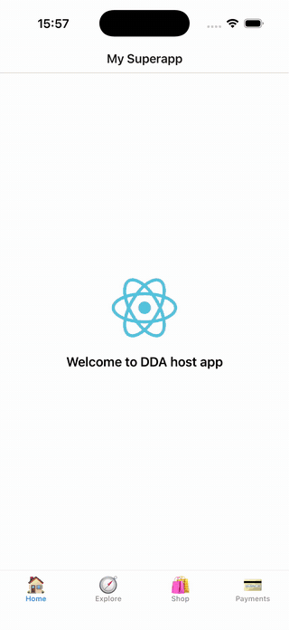
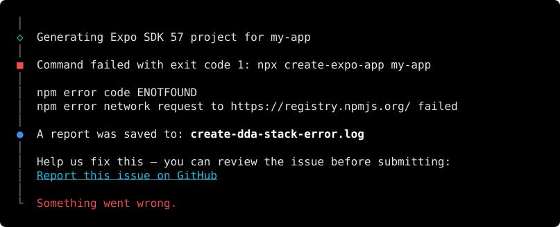

<p align="center">
  
</p>

# create-dda-stack

Build a React Native **superapp** in one command: a host app that loads mini-apps over the network, with Re.Pack and Module Federation already set up.

Setting up Module Federation in React Native by hand is slow and easy to get wrong. This does it for you, on React Native CLI or Expo. Regular Expo and React Native CLI apps are supported too.

<p align="center">
  
</p>

## Quick start

```bash
npx create-dda-stack@latest my-app --stack superapp
```

Use `--stack expo-superapp` for the same setup on Expo (SDK 56+), or leave out `--stack` and pick from a list. Works with npm, yarn, pnpm and bun.

## Build a superapp

The superapp stacks create two folders next to each other:

| Folder | What it is |
| --- | --- |
| `my-app-host` | The host app. It has a bottom tab for each mini-app and loads it at runtime |
| `my-app-remote` | Your first mini-app. It's a separate project with its own dev server |

Build the host once with the steps the CLI prints at the end. Then start every dev server from the host, in one terminal:

```bash
cd my-app-host
npm run dev:all
```

Then add as many mini-apps as you need. Each one gets its own tab in the host:

```bash
npx create-dda-stack@latest add-miniapp payments --title Payments --icon 💳
```

See [Add a mini-app to a superapp](#add-a-mini-app-to-a-superapp) for details.

## Secure storage with Keychain

> **New in 0.6.2.** Works on every stack.

Keep tokens and other secrets in the iOS Keychain / Android Keystore with [react-native-keychain](https://github.com/oblador/react-native-keychain). Say yes when the CLI asks about secure storage, or pass `--keychain`:

```bash
npx create-dda-stack@latest my-app --stack superapp --keychain
```

You get a typed helper in `src/storage/secureStorage.ts`:

```ts
import { setSecureItem, getSecureItem, clearSecureItems } from './storage/secureStorage';

await setSecureItem('auth_token', token);
const token = await getSecureItem('auth_token'); // string | null
await clearSecureItems(); // e.g. on sign-out
```

- **Pick your keys**: choose **Now** to type each key name and paste its value in the CLI, or **Later** to start with `auth_token` and `refresh_token` and edit them yourself. With flags, use `--keychain-keys` and `--keychain-value`.
- **Starting values**: values entered in the CLI go into the git-ignored `.env` and are copied to the keychain on first launch. They're inlined into the JS bundle, so use dev/test values there, and save real secrets at runtime with `setSecureItem`.
- **Axios**: if you include `auth_token`, the Axios client reads its token from the keychain.
- **Superapps**: the host and its mini-apps share the same keychain entries.

## Pick a stack

| Stack | Best for |
| --- | --- |
| **Superapp** | A host app that loads mini-apps (Re.Pack + Module Federation) |
| **Expo Superapp** | The same superapp setup on Expo (SDK 56+) |
| **Expo** | A single app, started fast. Pick Expo Router (file-based) or React Navigation |
| **React Native CLI** | A single app with full native control |

## What you get

Every app comes with:

- **Navigation** with bottom tabs (Home + Explore)
- **React Query** for data fetching
- **Axios** client with auth token handling
- **`.env`** config with types
- **ESLint + Prettier**, ready to run with `npm run lint`

You can also add:

- **State management**: Zustand or Redux Toolkit
- **NativeWind**: Tailwind CSS for React Native
- **Reactotron**: a desktop debugger
- **Secure storage**: react-native-keychain. See [Secure storage with Keychain](#secure-storage-with-keychain)

## Skip the questions

Pass flags to set up everything in one line:

```bash
npx create-dda-stack@latest my-app --stack expo --state zustand --pm pnpm --yes
```

| Flag | Options |
| --- | --- |
| `--stack` | `superapp`, `expo-superapp`, `expo`, `rn-cli` |
| `--state` | `none`, `zustand`, `redux-toolkit` |
| `--pm` | `npm`, `yarn`, `pnpm`, `bun` |
| `--router` | `expo-router`, `react-navigation` (Expo only) |
| `--nativewind` | Add NativeWind |
| `--reactotron` | Add Reactotron |
| `--keychain` | Add react-native-keychain (keys: `auth_token`, `refresh_token`) |
| `--keychain-keys` | Pick your own keys, e.g. `auth_token,api_key` |
| `--keychain-value` | Set a key's value now, e.g. `auth_token=dev-token` (repeat for more keys) |
| `--no-install` | Skip installing dependencies |
| `--yes` | Use defaults for anything not set |

See `npx create-dda-stack --help` for all flags, including version pinning.

## Add a mini-app to a superapp

Run this inside your host app (or the folder that contains it):

```bash
npx create-dda-stack@latest add-miniapp payments --title Payments --icon 💳
```

This creates a new sub-app next to the host and adds a new bottom tab for it in the host. The sub-app uses the same React Native (or Expo SDK), Re.Pack, state library and package manager as the host, and gets the next free dev port.

Then start everything from the host, in one terminal:

```bash
npm run dev:all                    # the host plus every mini-app in miniapps.json
npm run dev:all -- --reset-cache   # extra flags go to every dev server
```

`dev:all` prefixes each mini-app's output with its name, skips any mini-app that's already running, and stops them all on Ctrl+C. The host keeps the terminal's keyboard shortcuts (`r` to reload, `d` for the dev menu). You can still start each one yourself with `npm start` in its folder.

If a mini-app tab can't load (its dev server isn't running, or the host wasn't restarted), the tab says why and offers a **Reload app** button instead of crashing.

> [!IMPORTANT]
> **Restart the host's dev server after adding a mini-app.** The host only reads its list of mini-apps when the dev server starts. If it was already running, the new tab shows `Cannot find module 'payments/HomeScreen'` until you restart it. Reloading the app isn't enough, but you don't need to rebuild it with `npm run ios` either. `dev:all` won't start while the host is already running, for this reason. Stop the host first.

Each mini-app is one entry in the host's `miniapps.json`. Edit that file to change a tab's title or icon, or to set `prodUrl`: the address that serves `<platform>/mf-manifest.json` in release builds. Restart the host's dev server after a change.

If a mini-app uses a native module, install it in the host too and run `pod install` there. Sub-apps can't ship native code to the host.

See `npx create-dda-stack add-miniapp --help` for all flags.

## Requirements

Node.js 18 or newer.

## Report an issue

If something goes wrong, the CLI saves the details to `create-dda-stack-error.log` and prints a link to a pre-filled GitHub issue. Nothing is sent automatically — you review the issue and choose whether to submit it.

<p align="center">
  
</p>

## Contributing

```bash
pnpm install
pnpm dev     # run from source
pnpm build
```

## License

MIT
